#  API do Almoxarifado

**Atividade Prática – API e Consultas**
API REST em **PHP + PDO + PostgreSQL** para registrar e gerenciar as peças de reposição de um almoxarifado industrial, substituindo os cadernos e planilhas soltas por um controle centralizado.

---

## Sobre o projeto

A indústria não sabia ao certo quantas peças existiam no almoxarifado nem quanto dinheiro estava parado em estoque. Esta API resolve o problema permitindo **cadastrar, listar, atualizar e excluir** peças, além de gerar informações para a gerência por meio de consultas SQL.

##  Tecnologias

- PHP 8+ (com a extensão `pdo_pgsql` ativa)
- PDO (acesso ao banco com prepared statements)
- PostgreSQL
- JSON para entrada e saída de dados

##  Estrutura de arquivos

```
almoxarifado-api/
├── banco.sql        # criação do banco e da tabela
├── conexao.php      # conexão PDO com o PostgreSQL
├── index.php        # API (POST, GET, PUT, DELETE)
├── seed.php         # cadastra 12 peças usando o POST da API
├── consultas.sql    # 6 consultas para a gerência
└── README.md
```

---

## 1️ Criação do banco de dados

Banco: **`almoxarifado`**. Comando executado conectado ao banco padrão `postgres`:

```sql
CREATE DATABASE almoxarifado;
```

>  **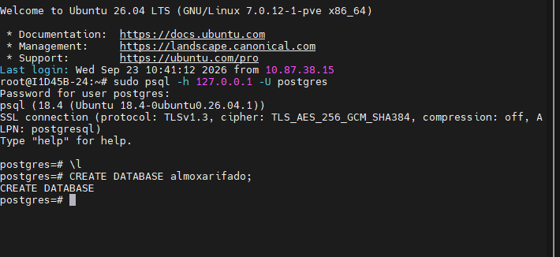** comando `CREATE DATABASE almoxarifado;` executado com sucesso (e o banco aparecendo na lista de bancos).

## 2️ Criação da tabela

Tabela: **`pecas`**, criada dentro do banco `almoxarifado`.

| Campo | Tipo | Regra |
|---|---|---|
| `id` | SERIAL | chave primária, incremento automático |
| `nome` | VARCHAR(100) | obrigatório |
| `categoria` | VARCHAR(20) | `eletrica`, `mecanica` ou `hidraulica` |
| `fornecedor` | VARCHAR(100) | obrigatório |
| `quantidade` | INTEGER | não pode ser negativa |
| `preco_unitario` | DECIMAL(10,2) | deve ser maior que zero |

```sql
CREATE TABLE pecas (
    id             SERIAL PRIMARY KEY,
    nome           VARCHAR(100)  NOT NULL,
    categoria      VARCHAR(20)   NOT NULL
                   CHECK (categoria IN ('eletrica', 'mecanica', 'hidraulica')),
    fornecedor     VARCHAR(100)  NOT NULL,
    quantidade     INTEGER       NOT NULL CHECK (quantidade >= 0),
    preco_unitario DECIMAL(10,2) NOT NULL CHECK (preco_unitario > 0)
);
```

>  **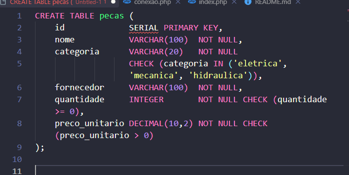** comando `CREATE TABLE pecas (...)` executado com sucesso.

>  **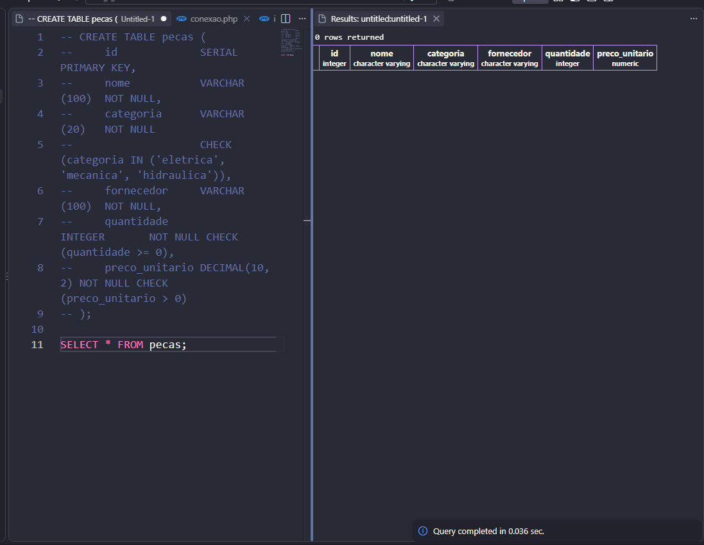** estrutura da tabela pronta (no `psql`: `\d pecas`, ou a aba de colunas do cliente gráfico).

---

## 3️ Como executar a API

1. Crie o banco e a tabela com o `banco.sql`.
2. Ajuste usuário e senha em `conexao.php`.
3. Dentro da pasta do projeto, suba o servidor embutido do PHP:

```bash
php -S localhost:8000
```

> **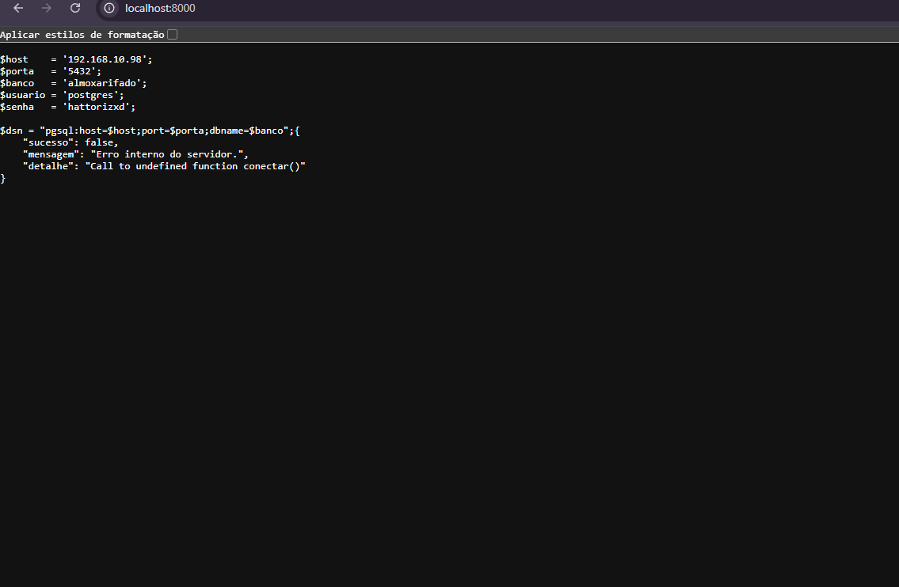** terminal com o servidor PHP rodando (`Development Server (http://localhost:8000) started`).

---

## 4️ Endpoints

| Método | URL | Ação |
|---|---|---|
| `POST` | `/index.php` | cadastra uma nova peça |
| `GET` | `/index.php` | lista todas as peças (`?id=3` busca uma só) |
| `PUT` | `/index.php?id=3` | atualiza uma peça pelo id |
| `DELETE` | `/index.php?id=3` | exclui uma peça pelo id |

### Regras de validação

- Todos os campos são obrigatórios: `nome`, `categoria`, `fornecedor`, `quantidade`, `preco_unitario`.
- `categoria` aceita apenas `eletrica`, `mecanica` ou `hidraulica`.
- `quantidade` deve ser inteira e **não negativa** (0 é aceito).
- `preco_unitario` deve ser numérico e **maior que zero**.
- Toda resposta é em JSON, com os campos `sucesso` e `mensagem`.

| Situação | Código HTTP |
|---|---|
| Cadastro realizado | 201 |
| Consulta, atualização ou exclusão realizadas | 200 |
| JSON inválido ou id ausente | 400 |
| Peça não encontrada | 404 |
| Dados inválidos (validação) | 422 |
| Método não permitido | 405 |
| Erro no banco ou no servidor | 500 |

---

## 5️ Testando as operações do CRUD

## 6 Cadastro das 12 peças pelo POST da API

O arquivo `Thunder Client` envia 12 requisições `POST` para a própria API (nenhum dado é inserido direto no banco). São 5 peças elétricas, 4 mecânicas e 3 hidráulicas, com quantidades e preços variados.

```bash
php seed.php
```

> **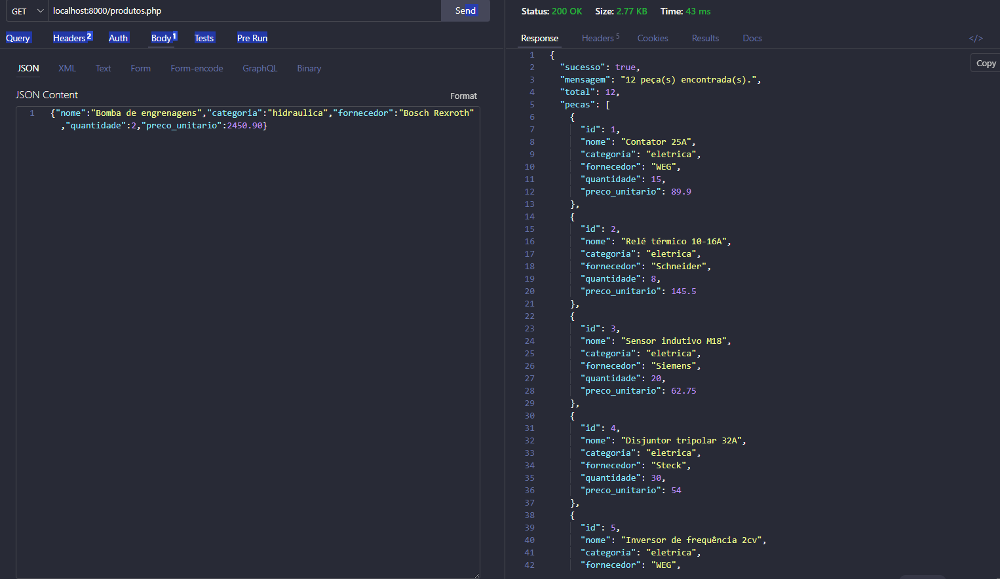 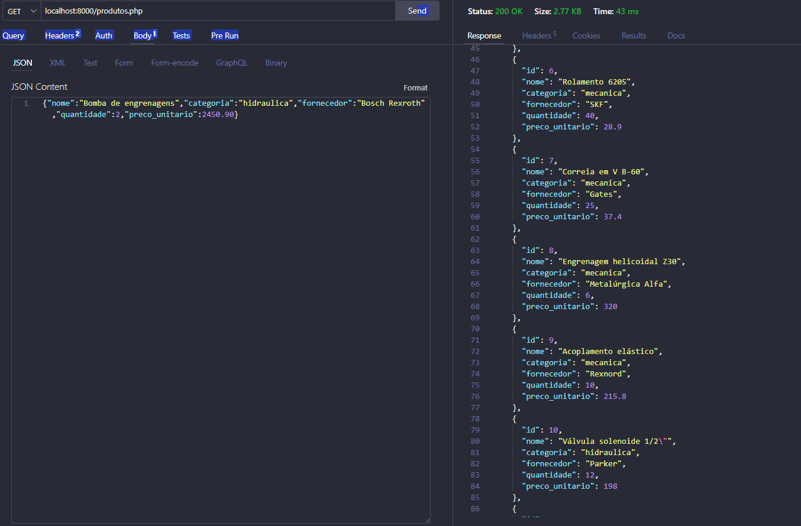 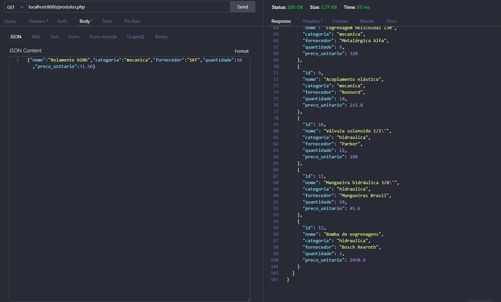** terminal executando `php seed.php`, com as 12 peças `[OK]` e a mensagem `12 de 12 peças cadastradas`.

> **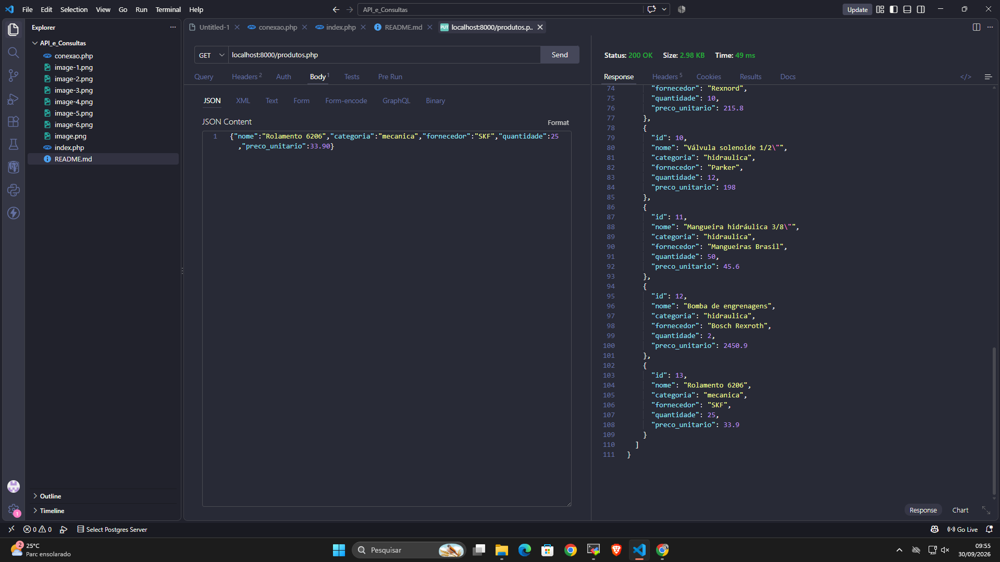** `SELECT * FROM pecas ORDER BY id;` no banco mostrando as 12 peças cadastradas.

---

## 7 Consultas para a gerência

Todas estão no arquivo `postgreSQL`.

### 7.1 Total de unidades no almoxarifado

```sql
SELECT SUM(quantidade) AS total_unidades
FROM pecas;
```

> **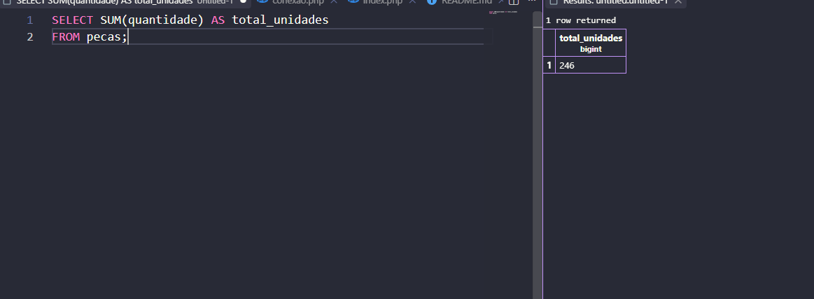** 

### 7.2 Valor total do estoque

```sql
SELECT SUM(quantidade * preco_unitario) AS valor_total_estoque
FROM pecas;
```

> **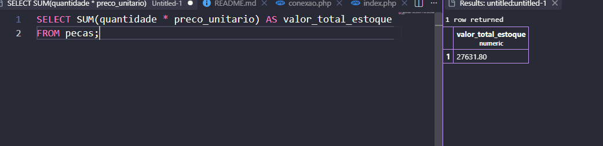** 

### 7.3 Preço da peça mais cara

```sql
SELECT MAX(preco_unitario) AS preco_mais_caro
FROM pecas;
```

> **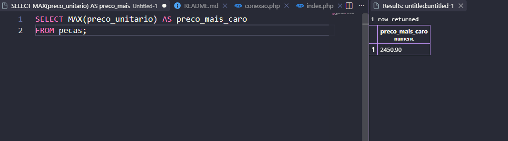**

### 7.4 Preço da peça mais barata

```sql
SELECT MIN(preco_unitario) AS preco_mais_barato
FROM pecas;
```

> **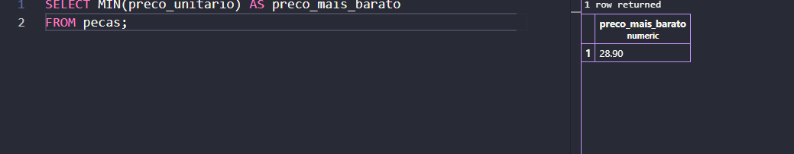**

### 7.5 Preço médio das peças (2 casas decimais)

```sql
SELECT ROUND(AVG(preco_unitario), 2) AS preco_medio
FROM pecas;
```

> **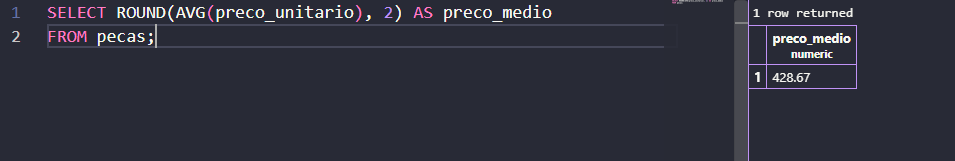**

### 7.6 Valor total em estoque da categoria elétrica

```sql
SELECT SUM(quantidade * preco_unitario) AS valor_total_eletrica
FROM pecas
WHERE categoria = 'eletrica';
```

>  **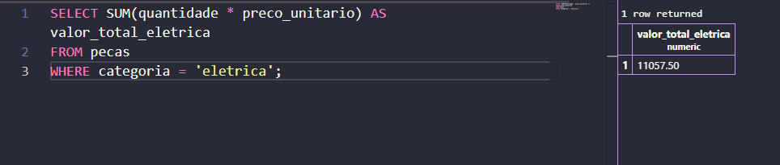**

---

## 8 Conclusão

A API permite controlar as peças do almoxarifado com validações de dados, respostas padronizadas em JSON e consultas que mostram à gerência quantas unidades existem, quanto dinheiro está parado em estoque e quais são os preços extremos e médio.

*Os valores "esperados" acima valem para as 12 peças cadastradas pelo `Thunder Cliente`, sem alterações.*
